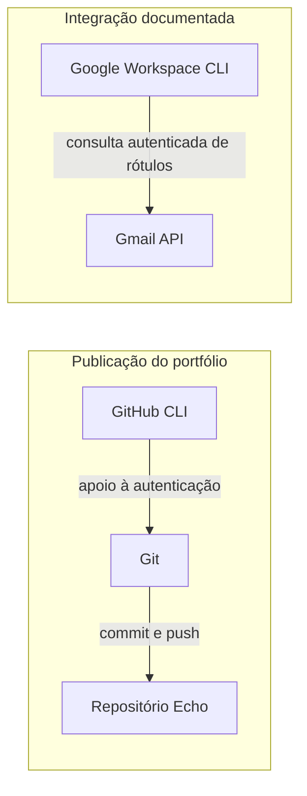

# Echo - Sandbox de AI

Bruno Entringer · AI Builder com foco em produto, dados e automação.

Do problema à implementação assistida por IA: experimentos,
decisões técnicas e evidências de evolução em um laboratório
público de aprendizado e construção.

> Em desenvolvimento: a base documental está publicada.
> O projeto reúne um estudo de caso de integração com Google
> Workspace CLI e está organizando seu inventário técnico.
> A demonstração reproduzível de um fluxo de IA ponta a ponta
> é o próximo marco.

## Por que o Echo existe

Ferramentas de IA só se tornam úteis quando conectadas a um
problema claro, a um processo de trabalho e a critérios de
validação.

O Echo registra essa construção: o que foi tentado, quais
decisões foram tomadas, o que funcionou e o que ainda precisa
ser demonstrado.

O foco de evolução do laboratório inclui:

- Integrações entre ferramentas de IA e serviços externos.
- Skills reutilizáveis e, futuramente, agentes especializados.
- Memória operacional para continuidade entre sessões.
- Automações com limites de permissão e supervisão humana.
- Documentação técnica que conecte implementação e evidência.

Essas frentes representam a direção do projeto, não uma
afirmação de que todas já estão implementadas.

## Primeiro estudo de caso: integração com Google Workspace CLI

Como preparar uma integração com Gmail sem confundir
autenticação, permissão e funcionamento comprovado?

O primeiro estudo de caso documenta uma consulta de rótulos
via Google Workspace CLI, o uso de OAuth e os limites das
evidências disponíveis.

| Aspecto | Registro atual |
|---|---|
| Operação documentada | Consulta de rótulos com `gws gmail users labels list` |
| Resultado observado | Retorno JSON com rótulos do sistema |
| Decisão de segurança | Separar consulta de dados de autorização para alterações |
| Limite da evidência | A consulta não comprova o conjunto exato de escopos concedidos |
| Ainda não demonstrado | Automação de triagem e limpeza de mensagens |

[Leia o estudo de caso](case-studies/01-gws-cli-oauth.md)

## Como trabalho com IA

Minha participação envolve definir o problema, estabelecer
requisitos, avaliar propostas técnicas, autorizar operações
e revisar as evidências apresentadas.

A IA auxilia na elaboração de comandos, implementação,
diagnóstico e documentação. Essa assistência não substitui
a revisão humana nem transforma uma saída de ferramenta
em prova de funcionamento completo.

O processo que orienta o Echo é:

**Problema → requisitos → implementação assistida → verificação → aprendizado → publicação**

Os registros distinguem o que foi relatado, configurado,
executado e efetivamente demonstrado.

## Base técnica atual

A base documentada reúne duas frentes:

As integrações acima não constituem, por si só, um fluxo
de IA ponta a ponta.

O inventário técnico separa definições locais, configurações
encontradas, operações documentadas e capacidades ainda
não verificadas. A existência de uma ferramenta ou skill
não é tratada como prova de uso.

[Arquitetura](docs/architecture.md) ·
[Inventário de capacidades](docs/capability-inventory.md)

## Decisões que orientam a construção

| Decisão | Motivo e limite |
|---|---|
| Separar ambiente privado e portfólio público | Reduz exposição acidental; ainda exige revisão do conteúdo |
| Publicar apenas arquivos explicitamente aprovados | Dá visibilidade ao conjunto enviado; depende de disciplina |
| Utilizar dados sintéticos em exemplos | Evita depender de dados privados para demonstrar funcionamento |
| Registrar estado, decisões e próximos passos | Apoia a continuidade; o carregamento da memória precisa ser verificado |
| Associar afirmações a evidências | Evita confundir instalação, configuração e resultado |

[Registro de decisões](docs/decisions.md) ·
[Política de segurança](SECURITY_POLICY.md)

## Diário de evolução

O diário de bordo registra objetivos, mudanças, decisões,
testes, resultados, limitações e próximos passos.

O primeiro marco publicado foi a estrutura inicial do Echo,
em 6 de novembro de 2026, no commit
[`b30257f`](https://github.com/entringerbruno/Echo/commit/b30257f8014bf0da7957fa9b455031320c65d220).

As próximas entradas acompanham o inventário técnico e
a evolução da documentação, distinguindo trabalho local
de conteúdo efetivamente publicado.

[Acompanhe o diário de bordo](JOURNAL.md)

## Próximos marcos

1. Demonstrar um fluxo de IA ponta a ponta com dados sintéticos,
   objetivo definido e critérios claros de sucesso.
2. Aprofundar o inventário de skills e integrações, verificando
   definições e usos sem presumir capacidades.
3. Documentar uma capacidade reutilizável com entradas,
   saídas, instruções e um exemplo verificável.
4. Melhorar a verificação pré-publicação e testar a retomada
   de contexto em uma nova sessão.

Esses marcos são propostas de evolução. Instalações,
ampliação de permissões e operações externas dependem
de autorização específica.

## Limites atuais

O Echo está em estágio inicial. Ainda não há demonstração
pública reproduzível de um fluxo de IA ponta a ponta.

O inventário é parcial; agentes customizados não foram
encontrados nos locais consultados, e a execução das skills
não foi comprovada pelas fontes analisadas. Conexões MCP
e permissões adicionais não são apresentadas como operacionais
sem verificação.

As verificações de segurança realizadas são triagens por
padrões, não garantia de ausência absoluta de segredos.

## Navegue pelo projeto

- [Diário de bordo](JOURNAL.md)
- [Estudo de caso: Google Workspace CLI](case-studies/01-gws-cli-oauth.md)
- [Arquitetura](docs/architecture.md)
- [Inventário de capacidades](docs/capability-inventory.md)
- [Decisões técnicas](docs/decisions.md)
- [Segurança e privacidade](SECURITY_POLICY.md)

---

Bruno Entringer · Produto, dados, automação e IA aplicada.
